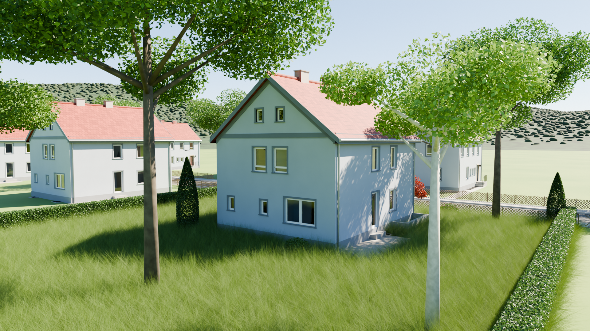

# Hausmodell

3D-Modell eines Einfamilienhauses (Bj. ca. 1950) in Blender, mit Druckdaten für ein stapelbares Modell aus drei Teilen.

- **Version:** 0.9.1
- **Software:** Blender 5.2.2 LTS, Bambu Studio
- **Stand:** 12.10.2026
- **Dokumentation:** [DOKUMENTATION.md](DOKUMENTATION.md)
- **Website:** https://d3m0naz.github.io/danzhouse/

## Inhalt

| Pfad | Inhalt |
|---|---|
| `haus.blend` | Hauptdatei: Haus mit Umgebung und Kameraflügen |
| `haus_light.blend` | Haus ohne Umgebung |
| `haus_light_ohne_terrasse.blend` | Haus ohne Umgebung und ohne Terrasse |
| `haus_eg.blend`, `haus_og.blend` | Erdgeschoss und Obergeschoss einzeln, ohne Decke |
| `3D/Bambu_Lab_P1S_ohne_Terrasse/` | aktuelles Druckset 1:60 mit Projektdatei und Druckanleitung |
| `3D/Bambu_Lab_P1S_ohne_Terrasse_1-90/` | kleinere Variante 1:90 (67 % von 1:60) mit Druckanleitung |
| `3D/Bambu_Lab_P1S/` | Druckset 1:60 mit Terrasse |
| `3D/Bambu_Lab_A2L/`, `Haus_M1-50_A2L.stl` | älteres Druckset 1:50, wird nicht mehr gepflegt |
