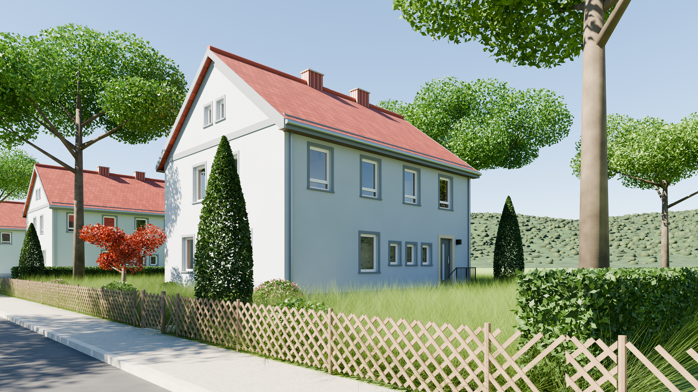
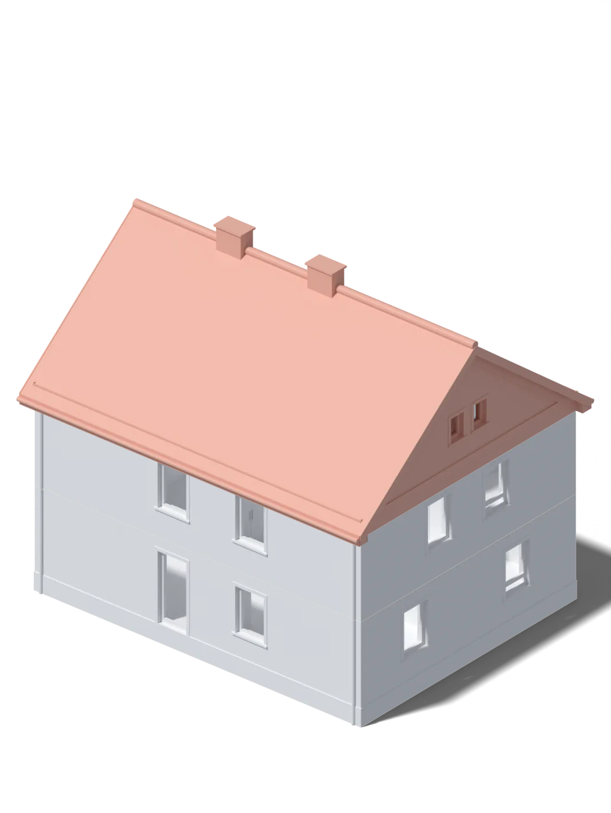
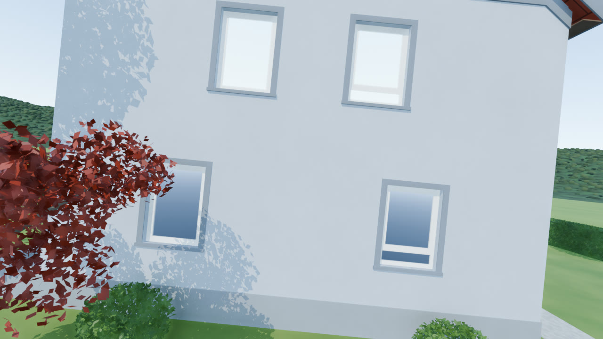

<div align="center">

# Hausmodell

**Ein Einfamilienhaus aus der Zeit um 1950 – Raum für Raum in Blender nachgebaut<br>und als stapelbares 3D-Druckmodell zum Abheben der Geschosse.**

[](https://github.com/d3m0naz/danzhouse/releases/tag/v0.9.2)
[](https://www.blender.org/)
[](https://bambulab.com/)
[](#3d-druck)

[**Website**](https://d3m0naz.github.io/danzhouse/) ·
[**Downloads**](https://github.com/d3m0naz/danzhouse/releases/tag/v0.9.2) ·
[**Dokumentation**](DOKUMENTATION.md) ·
[**Druckanleitung 1:60**](3D/Bambu_Lab_P1S_ohne_Terrasse/Druckanleitung_Haus_M1-60_P1S.pdf)

<br>



<sub>Ansicht von Nordosten mit der Haustür – gerendert in Blender.</sub>

</div>

<br>

## Das Projekt

Zwei Geschosse, ein steiles Ziegeldach, Faschen um die Fenster und ein Jägerzaun vor dem Haus: Das Modell bildet ein typisches Einfamilienhaus der Nachkriegszeit nach – außen wie innen. Wände, Türen, Treppen und Einbauschränke sind maßstäblich modelliert.

Aus dem Blender-Modell sind Druckdaten für ein Modell aus drei Teilen entstanden. Dach und Obergeschoss lassen sich abheben, darunter liegt jeweils der Grundriss des Geschosses.

<table>
<tr>
<td width="44%" align="center">

</td>
<td>

### Auf einen Blick

|  |  |
|---|---|
| 🏠 **Haus** | 11,98 × 9,41 m, Außenwände 38 cm |
| 🧱 **Geschosse** | Erdgeschoss und Obergeschoss, darüber das Satteldach |
| 🖨️ **Druckteile** | Erdgeschoss, Obergeschoss, Dach |
| 📐 **Maßstäbe** | 1:60 (ca. 18 cm hoch) und 1:90 (ca. 13 cm hoch) |
| ⏱️ **Druckzeit** | ca. 27 h (1:60) · ca. 17 h (1:90) |
| 🧵 **Material** | ca. 820 g (1:60) · ca. 390 g (1:90) PLA |
| 🎬 **Kameraflug** | 54 Sekunden durchs ganze Haus |

</td>
</tr>
</table>

## Im Haus

<table>
<tr>
<th width="50%">Erdgeschoss</th>
<th width="50%">Obergeschoss</th>
</tr>
<tr>
<td valign="top">

- Windfang mit Tür zur Diele
- Kellertreppe von der Diele
- Wohnen und Essen, durch einen Sturz verbunden
- Durchreiche zwischen Küche und Essen
- Treppe ins Obergeschoss, unten und oben gewendelt

</td>
<td valign="top">

- Zimmer 15, 16, 17 und 19
- Raumspartreppe aus Holz zum Dachboden
- Einbauschrank mit Waschtischnische
- Wandschränke in Zimmer 15 und 16
- farbige Wände und Böden, je nach Raum

</td>
</tr>
</table>

Außen: Putz hell-blaugrau, Faschen und Gesims grau, rote Ziegel, Haustür basaltgrau mit Glasstreifen und Sandsteingewände. Alle Maße und Farbwerte stehen in der [Dokumentation](DOKUMENTATION.md).

## 3D-Druck

Jedes Druckset besteht aus drei Teilen, die mit Stiften an den Ecken aufeinander gesteckt werden. Die Projektdateien für Bambu Studio sind fertig eingestellt und gesliced – öffnen, Platte wählen, drucken.

| | **1:60** – das große Modell | **1:90** – die kompakte Variante |
|---|---|---|
| **Höhe gestapelt** | ca. 18 cm | ca. 13 cm |
| **Erdgeschoss** | 201 × 177 × 60 mm | 136 × 119 × 41 mm |
| **Obergeschoss** | 201 × 160 × 48 mm | 136 × 108 × 33 mm |
| **Dach** | 209 × 174 × 81 mm | 141 × 117 × 55 mm |
| **Druckzeit** | 27 h 09 min | 16 h 54 min |
| **PLA** | 817 g · 270 m | 391 g · 129 m |
| **Schichthöhe** | 0,16 mm | 0,12 mm |
| **Besonderheit** | Dach und Sockel hohl, das spart Material | Wände mind. 1,2 mm, Stifte Ø 2,6 mm in Löchern Ø 3,0 mm |
| **Projektdatei** | [⬇ Haus_M1-60_P1S_Projekt.3mf](https://github.com/d3m0naz/danzhouse/releases/download/v0.9.2/Haus_M1-60_P1S_Projekt.3mf) | [⬇ Haus_M1-90_P1S_Projekt.3mf](https://github.com/d3m0naz/danzhouse/releases/download/v0.9.2/Haus_M1-90_P1S_Projekt.3mf) |
| **Einzelteile** | [STL-Dateien](3D/Bambu_Lab_P1S_ohne_Terrasse) | [STL-Dateien](3D/Bambu_Lab_P1S_ohne_Terrasse_1-90) |
| **Anleitung** | [Druckanleitung (PDF)](3D/Bambu_Lab_P1S_ohne_Terrasse/Druckanleitung_Haus_M1-60_P1S.pdf) | [Druckanleitung (PDF)](3D/Bambu_Lab_P1S_ohne_Terrasse_1-90/Druckanleitung_Haus_M1-90_P1S.pdf) |

<sub>Werte aus Bambu Studio für Bambu PLA Basic, 0,4-mm-Düse, 15 % Gyroid, Druckplatte Textured PEI.</sub>

> [!NOTE]
> Das Set 1:90 ist neu und noch nicht testgedruckt. Wer es druckt, beginnt am besten mit dem Obergeschoss und prüft, wie die Stifte in den Löchern sitzen.

### In drei Schritten zum Modell

1. **Projektdatei laden** – die `.3mf` in Bambu Studio öffnen. Jedes Teil liegt auf einer eigenen Druckplatte.
2. **Drucken** – Platte für Platte, Stützen und Einstellungen sind schon gesetzt.
3. **Stecken** – Obergeschoss auf das Erdgeschoss, Dach obendrauf. Die Stifte an den Ecken halten die Teile in Position.

## Kameraflug

<a href="https://d3m0naz.github.io/danzhouse/#drohnenflug">
  
</a>

Einmal ums Haus, durch die Terrassentür, durch Erdgeschoss und Obergeschoss und zum Fenster wieder hinaus – **[▶ Video auf der Website ansehen](https://d3m0naz.github.io/danzhouse/#drohnenflug)** (54 s, ohne Ton).

## Blender-Dateien

Die Blender-Dateien liegen im [Release 0.9.2](https://github.com/d3m0naz/danzhouse/releases/tag/v0.9.2) und im Repository. Erstellt mit Blender 5.2.2 LTS.

| Datei | Inhalt | Größe |
|---|---|---:|
| [`haus.blend`](https://github.com/d3m0naz/danzhouse/releases/download/v0.9.2/haus.blend) | Haus mit Umgebung – Straße, Zaun, Bäume, Nachbarhäuser – und drei Kameraflügen | 43 MB |
| [`haus_light.blend`](https://github.com/d3m0naz/danzhouse/releases/download/v0.9.2/haus_light.blend) | nur das Haus, mit Terrasse | 0,3 MB |
| [`haus_light_ohne_terrasse.blend`](https://github.com/d3m0naz/danzhouse/releases/download/v0.9.2/haus_light_ohne_terrasse.blend) | nur das Haus, ohne Terrasse – Grundlage der Drucksets | 0,3 MB |
| [`haus_eg.blend`](https://github.com/d3m0naz/danzhouse/releases/download/v0.9.2/haus_eg.blend) | Erdgeschoss ohne Decke, für den Blick in die Räume | 0,2 MB |
| [`haus_og.blend`](https://github.com/d3m0naz/danzhouse/releases/download/v0.9.2/haus_og.blend) | Obergeschoss ohne Decke, für den Blick in die Räume | 0,2 MB |

## Aufbau des Repositorys

```
danzhouse/
├── haus.blend, haus_*.blend          Blender-Dateien
├── Ansicht_Nordost_FullHD.png        Ansicht des Hauses
├── DOKUMENTATION.md                  Aufbau, Maße, Farben, Druckeinstellungen
├── 3D/
│   ├── Bambu_Lab_P1S_ohne_Terrasse/       Druckset 1:60 – STL, 3MF, PDF
│   ├── Bambu_Lab_P1S_ohne_Terrasse_1-90/  Druckset 1:90 – STL, 3MF, PDF
│   ├── pruefe_druckteile.py               prüft Druckteile
│   └── druckanleitung.py                  erzeugt die Druckanleitungen
└── docs/                             Website (GitHub Pages)
```

<details>
<summary><b>Werkzeuge für eigene Änderungen</b></summary>

<br>

Wer die Druckteile verändert, kann sie mit zwei Skripten prüfen und die Anleitungen neu erzeugen.

**Druckteile prüfen** – Topologie, Wandstärke, Stifte und Löcher:

```
python3 3D/pruefe_druckteile.py 3D/Bambu_Lab_P1S_ohne_Terrasse/Haus_M1-60_*.stl
```

**Druckanleitung erzeugen** – Maße, Zeiten und Material aus STL und Projektdatei, Bilder aus Blender:

```
python3 3D/druckanleitung.py 1-60
python3 3D/druckanleitung.py 1-90
```

Voraussetzungen und Details stehen in der [Dokumentation](DOKUMENTATION.md#druckteile-prüfen).

</details>

## Entstehung

Das Modell entstand in Blender, die Druckdaten wurden mit Hilfe des Sprachmodells Claude erzeugt und Schritt für Schritt verbessert: Dach und Sockel wurden hohl, dünne Stellen an Treppe und Traufkästen verstärkt, und aus dem Set 1:60 entstand die kleinere Variante 1:90.

<br>

<div align="center">
<sub>Hausmodell · Version 0.9.2 · Stand 19.10.2026</sub>
</div>
